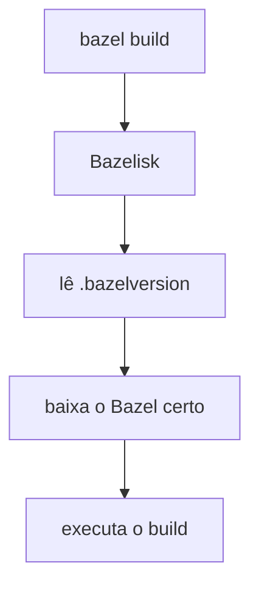
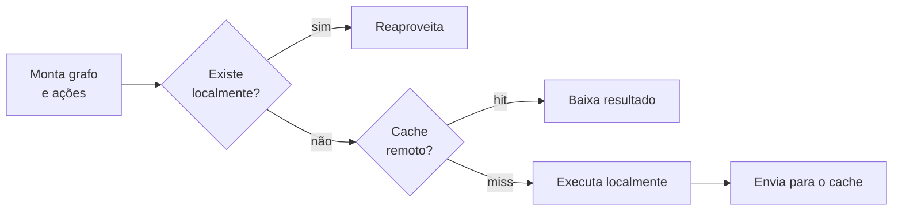
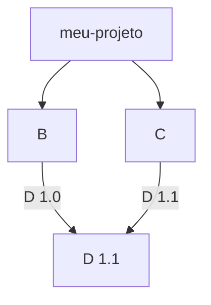

# Bazel

Build e teste rápidos, corretos e reproduzíveis

<div class="pt-8 opacity-80">
Joaquim · Vitor · Arlindo · Astolfi · Gabriel
</div>

<!--
Joaquim abre o seminário. Apresentar o grupo e o roteiro rapidamente.
-->

---
layout: default
---

# Roteiro

| Parte | Tema | Quem |
|---|---|---|
| 1 | Abertura e facilidade de configuração | Joaquim |
| 2 | Eficiência de compilação e dependências | Vitor |
| 3 | Multiplataforma e automação de tarefas | Arlindo |
| 4 | Extensibilidade, comunidade, vantagens e desvantagens | Astolfi |
| 5 | Demo ao vivo | Gabriel |

---
layout: section
---

# Parte 1
## Abertura e facilidade de configuração

<div class="opacity-60 pt-4">Joaquim</div>

---

# O que é o Bazel

<v-clicks>

- Ferramenta open-source de **build e teste**, na linha de Make, Maven e Gradle
- Versão aberta do **Blaze**, usado internamente no Google (Bazel é anagrama de Blaze)
- Lançado em março de 2015, versão 1.0 em outubro de 2019
- Só cerca de 10% das regras do Blaze foram abertas; o resto é específico do Google
- Objetivos: **velocidade** (cache e paralelismo), **builds reproduzíveis** e **várias linguagens** no mesmo repositório

</v-clicks>

<v-click>

> Um build no CI deve gerar saídas idênticas, bit a bit, às da máquina do desenvolvedor.

</v-click>

---

# Arquivos de um projeto

| Arquivo | Papel |
|---|---|
| `MODULE.bazel` | Raiz do projeto, nome do módulo e dependências externas (Bzlmod) |
| `BUILD` / `BUILD.bazel` | Um por *package*. Declara os targets: o que construir |
| `.bazelrc` | Flags de linha de comando salvas em arquivo |
| `.bazelversion` | Fixa a versão do Bazel, lida pelo Bazelisk |

<v-click>

<div class="mt-6 p-4 rounded bg-amber-500/10 border-l-4 border-amber-500">

`MODULE.bazel` substituiu o `WORKSPACE`: padrão desde o Bazel 7, `WORKSPACE` desativado no 8 e removido no 9.
Tutoriais com `WORKSPACE` estão desatualizados.

</div>

</v-click>

---

# `.bazelrc`: personalizar sem editar o build

````md magic-move
```bash
# .bazelrc
build --verbose_failures
```
```bash
# .bazelrc
build --verbose_failures
build:release --compilation_mode=opt     # perfil nomeado
```
```bash
# .bazelrc
build --verbose_failures
build:release --compilation_mode=opt     # perfil nomeado
try-import %workspace%/user.bazelrc      # ajustes pessoais, fora do git
```
````

<v-click>

```bash
bazel build --config=release //app:server
```

</v-click>

<v-clicks>

- Configuração em camadas: sistema, projeto e usuário
- `--config=foo` expande as opções do perfil `foo`
- `user.bazelrc` por último, para cada dev sobrescrever o que precisar

</v-clicks>

---

# Targets, labels e regras

<div class="grid grid-cols-2 gap-6">
<div>

```python
# lib/BUILD.bazel
cc_library(
    name = "utils",
    srcs = ["utils.cc"],
    hdrs = ["utils.h"],
)

# app/BUILD.bazel
cc_binary(
    name = "server",
    srcs = ["main.cc"],
    deps = ["//lib:utils"],
)
```

</div>
<div>

<v-clicks>

- **Regra**: modelo (`cc_binary`, `java_library`, `py_binary`)
- **Target**: instância de uma regra ou um arquivo-fonte
- **Label**: `@repo//pacote:nome`
- Você declara **o quê**, não os comandos do compilador
- Targets + deps formam um **grafo acíclico** (target graph)

</v-clicks>

</div>
</div>

<v-click>

```bash
bazel build //app:server
```

</v-click>

---

# Instalação e Bazelisk

<div class="grid grid-cols-2 gap-8">
<div>

```bash
brew install bazelisk          # macOS
choco install bazelisk         # Windows
npm install -g @bazel/bazelisk
```

```bash
# testar outra versão sem mexer no repo
USE_BAZEL_VERSION=8.1.0 bazel build //...
```

</div>
<div>



</div>
</div>

<v-click>

Todo o time usa a mesma versão do Bazel, e quem nunca usou Bazel só precisa instalar o Bazelisk.

</v-click>

---

# Resumo: configuração declarativa

<v-clicks>

- `MODULE.bazel` e `BUILD` descrevem **o que** construir, sem scripts imperativos
- `.bazelrc` e `--config` personalizam **como** construir
- `.bazelversion` + Bazelisk garantem o mesmo ambiente para todos
- Contrapartida: **curva de aprendizado** (labels, regras, migração para Bzlmod)

</v-clicks>

---
layout: section
---

# Parte 2
## Eficiência de compilação e gerenciamento de dependências

<div class="opacity-60 pt-4">Vitor</div>

---

# Por que o Bazel é rápido

<v-clicks>

- **Build baseado em artefatos**: o Bazel decide *como* e paraleliza passos independentes
- **Incremental**: só reconstrói o que foi afetado pela mudança
- **Correto**: só pula um passo se entradas, comando e saídas forem idênticos. Sem `make clean`
- **Null build**: no exemplo da documentação, de **9,9 s** para **0,14 s**

</v-clicks>

<v-click>


</v-click>

---

# Hermeticidade, sandbox e cache

<v-clicks>

- Mesmas entradas, mesma saída, independente da máquina
- Cada ação roda em um **sandbox** só com as entradas declaradas (padrão em Linux e macOS)
- Cada ação é identificada por **hash**, o que torna o cache seguro de compartilhar

</v-clicks>

<v-click>

| Recurso | O que faz | Como ativar |
|---|---|---|
| Cache em disco | Reaproveita entre branches e cópias | `--disk_cache=caminho` |
| Cache remoto | Compartilha entre time e CI | `--remote_cache=http://host:porta` |
| Execução remota | Distribui ações em várias máquinas | Serviço gRPC compatível |

</v-click>

---

# Como um build usa o cache remoto



<v-click>

O cache remoto guarda o **action cache** (hash da ação → resultado) e o **CAS** (arquivos endereçados por conteúdo).

</v-click>

---

# Gerenciamento de dependências (Bzlmod)

<div class="grid grid-cols-2 gap-6">
<div>

```python
# MODULE.bazel
module(name = "meu-projeto", version = "1.0")
bazel_dep(name = "rules_cc", version = "0.1.1")
```



</div>
<div>

<v-clicks>

- Só dependências **diretas**; transitivas resolvidas sozinhas
- **Bazel Central Registry** (ou registro próprio via `--registry`)
- **MVS**: escolhe a maior versão pedida, não a mais nova
- **Deps estritas**: cada módulo só vê o que declarou
- `MODULE.bazel.lock` com hashes, versionado no git
- Hash não bate, build falha
- `bazel fetch` + `--nofetch` para build offline

</v-clicks>

</div>
</div>

---

# Outros ecossistemas

| Ecossistema | Extensão |
|---|---|
| Maven | `rules_jvm_external` |
| PyPI | `rules_python` |
| Go | `bazel-gazelle` |
| Cargo | `rules_rust` |

<v-click>

Ajustes manuais no módulo raiz: `single_version_override`, `git_override`, `local_path_override`.

</v-click>

<v-click>

<div class="mt-4 opacity-80">

Este repo usa os dois primeiros. Vamos ver na demo.

</div>

</v-click>

---
layout: section
---

# Parte 3
## Multiplataforma e automação de tarefas

<div class="opacity-60 pt-4">Arlindo</div>

---

# Suporte a multiplataformas

<v-clicks>

- Roda em **Linux, macOS e Windows**
- Várias linguagens no mesmo build: Java, C/C++, Python, Go, Rust, JavaScript, Android, iOS…
- **Plataformas**: descrevem onde o build roda (*host/execution*) e para onde gera (*target*)
- **Toolchains**: o Bazel escolhe o compilador certo para cada plataforma
- **Compilação cruzada**: `--platforms=//plataformas:linux_arm64`
- Toolchains **herméticas**: JDK e Python baixados pelo próprio Bazel

</v-clicks>

<!--
Arlindo: completar com as anotações e fontes da Parte 3 (bazel.build/extending/platforms e bazel.build/extending/toolchains).
-->

---

# Automação de tarefas

<div class="grid grid-cols-3 gap-4 mt-6">

<div class="p-4 rounded bg-blue-500/10">

### `bazel build`
Compila os targets e gera os artefatos em `bazel-bin/`

</div>

<div class="p-4 rounded bg-green-500/10">

### `bazel test`
Roda os testes em paralelo e guarda os resultados em cache

</div>

<div class="p-4 rounded bg-purple-500/10">

### `bazel run`
Constrói e executa um binário em um único comando

</div>

</div>

<v-clicks>

- Empacotamento como target: *deploy jar*, `pkg_tar`, imagens OCI (`rules_oci`)
- No CI, o mesmo comando local: `bazel test //...`
- Cache remoto compartilhado faz o CI reaproveitar o trabalho dos devs

</v-clicks>

---
layout: section
---

# Parte 4
## Extensibilidade, comunidade e suporte

<div class="opacity-60 pt-4">Astolfi</div>

---

# Extensibilidade com Starlark

<div class="grid grid-cols-2 gap-6">
<div>

```python
# minhas_macros.bzl
load("@rules_cc//cc:defs.bzl",
     "cc_library", "cc_test")

def biblioteca_com_teste(name, srcs, hdrs, testes):
    cc_library(name = name, srcs = srcs, hdrs = hdrs)
    cc_test(
        name = name + "_test",
        srcs = testes,
        deps = [":" + name],
    )
```

</div>
<div>

<v-clicks>

- **Starlark**: dialeto de Python, determinístico, hermético e sempre finito
- Extensões em arquivos `.bzl`, importadas com `load`
- **Macros**: funções que criam targets (fase de carregamento)
- **Regras**: acessam o interior do Bazel e geram ações (fase de análise)
- Também: *aspects*, *repository rules*, Buildifier

</v-clicks>

</div>
</div>

---

# Ecossistema e comunidade

<div class="grid grid-cols-2 gap-6">
<div>

### Regras recomendadas
Android, C/C++, Docker/OCI, Go, Java, JavaScript, Maven, Protobuf, Python, Rust, Scala, Shell… distribuídas pelo **Bazel Central Registry**.

### Canais de ajuda
bazel-discuss, GitHub Discussions, Stack Overflow, Slack, issues no GitHub.

</div>
<div>

### Eventos e ferramentas
- **BazelCon 2026**: Amsterdã, 13 a 15 de outubro (esta semana)
- **BUILD Foundation** na Linux Foundation (BazelCon 2025)
- Plugins da JetBrains para IntelliJ, CLion, GoLand e PyCharm

</div>
</div>

---

# Versões e quem usa

<div class="grid grid-cols-2 gap-6">
<div>

| Trilha | Frequência |
|---|---|
| Rolling | A cada 2 semanas |
| LTS maior | ~12 meses |
| LTS menor | A cada 2 meses |
| Patch | Quando necessário |

Hoje: **Bazel 9** ativo, com suporte até dez/2028.

</div>
<div>

<v-clicks>

- **Google**: todo o software, milhões de builds por dia
- **Canva**: CI 5 a 6× mais rápido
- **Redfin**: CI de 40–90 min para 5–6 min
- **Uber**: monorepo Go com 900 devs
- TensorFlow, Angular, Envoy, gRPC
- No Brasil: **Acqio**

</v-clicks>

</div>
</div>

---

# Vantagens e desvantagens

<div class="grid grid-cols-2 gap-8">
<div class="p-4 rounded bg-green-500/10">

### Vantagens
- Configuração declarativa e versionada
- Builds incrementais corretos e paralelos
- Cache local e remoto compartilhável
- Dependências fixadas por lockfile e hash
- Várias linguagens e plataformas no mesmo repo
- Extensível com Starlark

</div>
<div class="p-4 rounded bg-red-500/10">

### Desvantagens
- Curva de aprendizado alta
- Tutoriais antigos usam `WORKSPACE`
- Cache exige ambiente bem controlado
- Escrever regras é para usuários avançados
- Mudanças incompatíveis entre LTS
- Qualidade varia fora das regras recomendadas

</div>
</div>

---
layout: section
---

# Parte 5
## Demo ao vivo

<div class="opacity-60 pt-4">Gabriel</div>

---

# O projeto da demo

Um monorepo com **dois microsserviços** em linguagens diferentes, construídos pelo mesmo Bazel.

| Serviço | Stack | Endpoint |
|---|---|---|
| `//java_api` | Java 21, Spring Boot | `GET /api/java/status` |
| `//python_api` | Python 3.12, FastAPI | `GET /api/python/status` |

<v-click>

Nenhum JDK ou Python instalado na máquina: o Bazel baixa as toolchains.

</v-click>

---

# Roteiro da demo

<v-clicks>

1. **Estrutura**: `MODULE.bazel`, `BUILD` e o código-fonte
2. **Build**: `bazel build //...` e o artefato em `bazel-bin/`
3. **Cache**: rodar de novo e comparar o tempo
4. **Incremental**: alterar um arquivo e reconstruir
5. **Executar**: `bazel run` e `curl` nos endpoints

</v-clicks>

<!--
Comandos de apoio:

bazel build //...
ls -lh bazel-bin/java_api/
bazel build //java_api:java_api_deploy.jar   # jar único com todas as deps
bazel build //...                            # null build, ver "N processes"

sed -i '' 's/"ok"/"ok, via Bazel"/' java_api/src/main/java/com/example/javaapi/StatusController.java
bazel build //...                            # só o Java é refeito
git checkout -- java_api/                    # desfazer depois

bazel query //...
bazel run //java_api        # terminal 1
bazel run //python_api      # terminal 2
curl http://127.0.0.1:8080/api/java/status
curl http://127.0.0.1:8000/api/python/status
-->

---
layout: center
class: text-center
---

